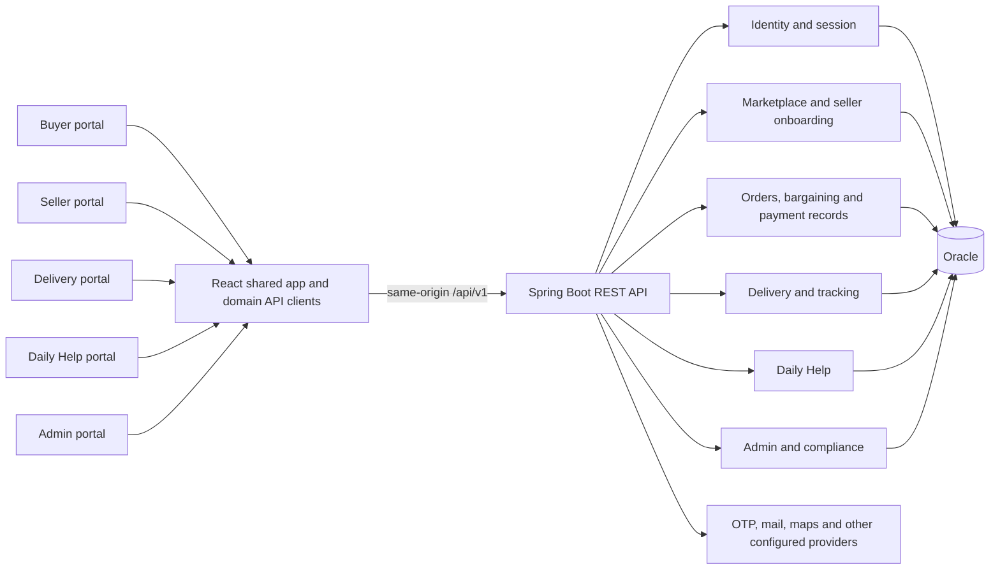
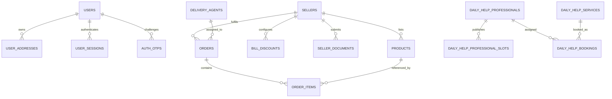
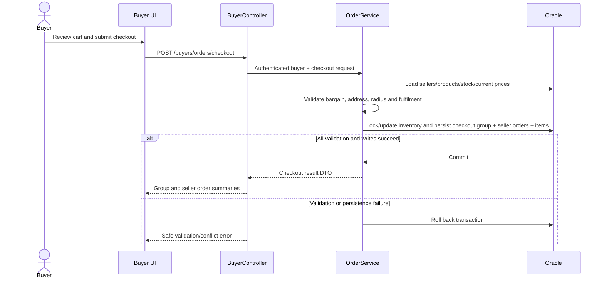
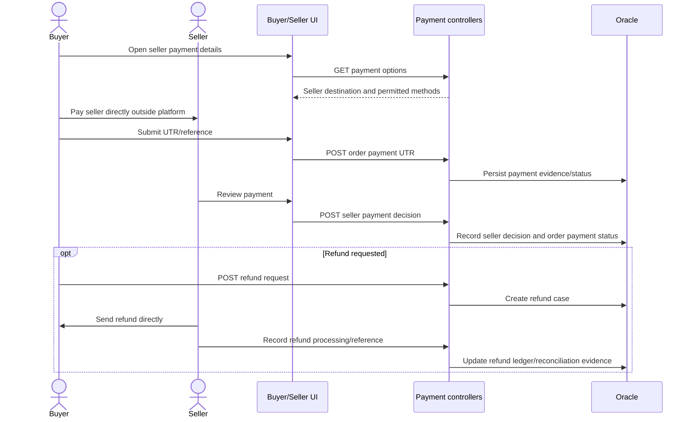
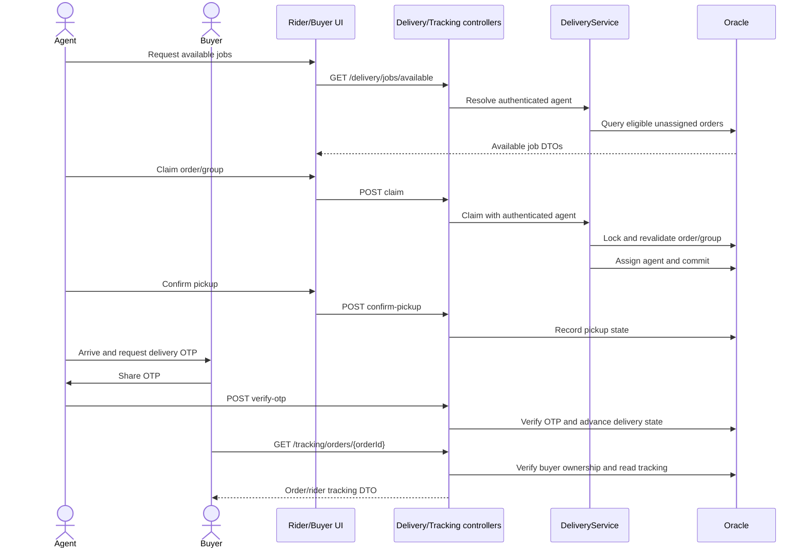
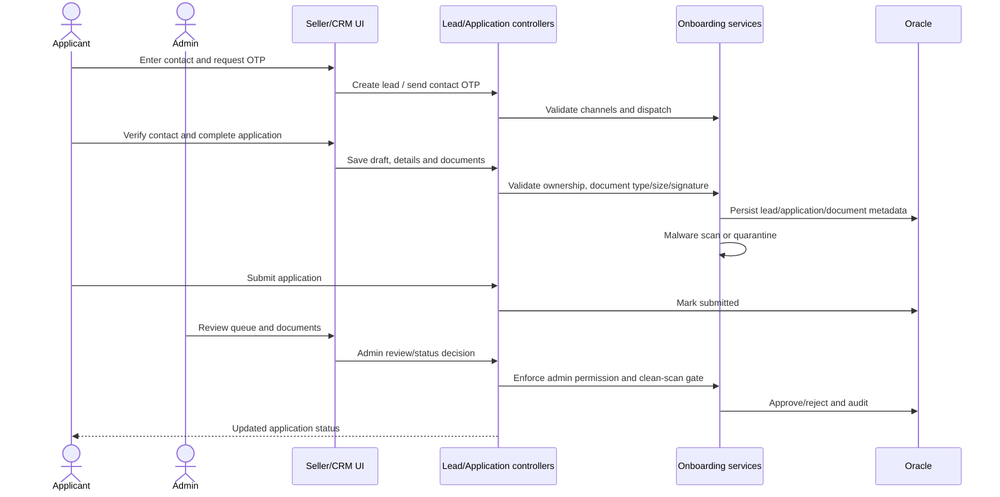

# KuraliUpdates — All Product Flows, APIs and Data Architecture

> Source-oriented system guide for the current repository. Read with `README.md`, `ARCHITECTURE.md`, [API index](API.md), [database guide](DATABASE.md), [Daily Help detailed design](DAILY-HELP-END-TO-END.md), [seller onboarding](SELLER-ONBOARDING.md), [buyer payment lifecycle](BUYER-PORTAL-PAYMENT-LIFECYCLE.md), [order lifecycle E2E matrix](ORDER-LIFECYCLE-E2E-MATRIX.md), and [security release checkpoint](SECURITY-RELEASE-2026-11-22.md). Controller/DTO/service/entity/migration source is authoritative. This guide describes source-observed flows and clearly marks decisions or runtime evidence that remain unverified.

## 1. Scope and system context

KuraliUpdates is a Kurali, Punjab hyperlocal platform with two customer journeys:
- **Online Shop:** browse products, bargain where enabled, checkout from one or more sellers, fulfilment and seller-direct payment.
- **Daily Help:** discover local services, choose a verified professional's published time window, book a duration/start time and manage the service job.

Role portals are Buyer, Seller, Delivery/Rider, Daily Help Professional and Admin. The backend is a Spring Boot modular monolith, not independently deployed domain microservices.



**Runtime boundary:** browser → React/Vite → REST API → Spring Boot → Oracle. Vercel/Render provider labels do not prove a separate production environment; the documented owner-designated environment is shared staging. Check live configuration and deployment evidence before making runtime claims.

## 2. Actors and authorization boundaries

| Actor | Main capabilities | Server-side boundary |
|---|---|---|
| Public visitor | Landing page, public discovery and registration entry | Only explicitly public endpoints |
| Buyer | Account, addresses, catalogue, cart/checkout, negotiation, order/payment/tracking, Daily Help | Authenticated BUYER role; ownership derived from session |
| Seller | Application/profile, documents, catalogue, availability, seller orders, payment destination and payment decisions | Authenticated SELLER role; seller record linked to session identity |
| Delivery agent | Profile/availability, available jobs, claim, pickup/delivery OTP, location | Authenticated DELIVERY role; only own assigned jobs |
| Daily Help professional | Profile, online status, availability windows, jobs, start/completion | Authenticated PROFESSIONAL role; own profile/slots/jobs |
| Admin | Onboarding review, operational configuration, order support, compliance and security administration | Admin authority plus endpoint-specific permission/step-up rules |
| Backend | Validation, state transitions, transaction and audit enforcement | Never trust client-supplied actor identity or ownership |

Client route guards and hidden buttons are usability controls only. Backend authentication, role, record ownership, status and state-transition checks are authoritative.

## 3. Cross-cutting authentication and session flow

### 3.1 OTP sign-in / registration

1. Browser obtains CSRF state using the auth CSRF endpoint when required by the configured browser security flow.
2. Client performs registration identity pre-check where applicable and loads admin-controlled OTP channel settings.
3. Client requests OTP dispatch. The server applies channel configuration, identity checks, throttling/cooldown and provider dispatch.
4. User submits the OTP. Server verifies the challenge and resolves or creates the account/role according to the requested journey.
5. Server creates/updates the persistent session and returns the configured browser session mechanism. Browser sessions use Secure, HttpOnly, host-only cookies with double-submit CSRF; token references are hashed at rest in the session store after V43.
6. Client bootstraps `/auth/me` and `/auth/me/roles`, then selects an authorized portal.
7. Logout revokes the server session; client clears in-memory identity and returns to the public entry.

The precise OTP channel requirements are configuration-driven. Do not assume email and mobile are always both mandatory. Never log OTPs, bearer/session tokens, CSRF secrets or provider credentials.

### 3.2 Cross-portal handoff

A role switch may use a server-persisted, short-lived, one-time portal handoff rather than copying credentials into a URL. The source portal requests a handoff; the destination redeems it; server validates expiry, single use, session and role. Query/hash stripping and cross-origin redirect rules are defined in the route helpers. A UI role switch is not permission elevation: the server must confirm the account has the target role.

### 3.3 Session lifecycle and admin MFA

- Browser session cookie: Secure, HttpOnly, host-only; CSRF double-submit protection.
- V43 stores a hash/reference of the opaque session token at rest.
- V46 adds browser idle timeout, absolute expiry and active-use rotation behavior; the reviewed checkpoint describes 30-minute idle and 12-hour absolute expiry.
- Admin TOTP MFA and recovery codes are separate from ordinary buyer/partner OTP. Sensitive admin actions may require step-up authentication.
- Account status changes and session revocation are admin-controlled and must be audited.
- CSP was documented as report-only at the 22-Nov checkpoint; do not describe it as enforced without a newer verified deployment.

### Auth API inventory

Base prefix is `/api/v1`; the controller class mapping is shown below without repeating that prefix.

| Controller | Method + path | Purpose |
|---|---|---|
| AuthController | `POST /auth/send-otp` | Dispatch configured OTP |
| AuthController | `POST /auth/registration-check` | Registration identity/pre-check |
| AuthController | `GET /auth/csrf` | Browser CSRF bootstrap |
| AuthController | `POST /auth/verify-otp` | Verify OTP and establish session |
| AuthController | `POST /auth/refresh` | Session refresh where configured |
| AuthController | `POST /auth/portal-handoff` | Create one-time portal handoff |
| AuthController | `POST /auth/portal-handoff/redeem` | Redeem handoff at destination |
| AuthController | `GET /auth/me`, `GET /auth/me/roles` | Current identity and roles |
| AuthController | `GET /auth/onboarding-status` | Current onboarding state |
| AuthController | `PUT /auth/me` | Update own account profile |
| AuthController | `GET/POST /auth/me/addresses` | List/create own saved addresses |
| AuthController | `PUT /auth/me/addresses/{addressId}` | Update own address |
| AuthController | `PUT /auth/me/addresses/{addressId}/default` | Set default address |
| AuthController | `POST /auth/logout` | Revoke current session |

The controller source is authoritative for payload fields, response DTOs, throttling and optional channels.

## 4. Buyer — Online Shop flow

### 4.1 Discover and build cart

1. Buyer chooses Online Shop and sets/chooses delivery address.
2. Frontend loads product/seller catalogue and search results.
3. Search filters and locality/radius configuration determine eligible sellers/products.
4. Product cards show current price, stock and seller. Server values are authoritative at checkout.
5. Buyer adds items and adjusts quantity. The UI cart is a working selection, not a reservation of stock or price.
6. If bargaining is enabled, buyer opens/uses a negotiation thread and sends an explicit offer. The offer is not sent merely because the buyer opened the bargaining action. Accepted offers can be reflected in the cart and must be validated server-side at checkout.

### 4.2 Bargaining / negotiation

1. Buyer creates or reads a negotiation conversation associated with a seller/product context.
2. Messages and offer events are persisted by the negotiation API.
3. Seller receives/listens to negotiation notifications and reviews the offer.
4. Seller accepts, rejects or otherwise responds using the offer-response API.
5. Only an accepted, still-valid offer can determine the negotiated line price during order creation. Do not trust a client-provided negotiated price or an old offer.
6. Read/notification state is maintained separately from the order itself.

API family: `/negotiations` — list/create conversations; `GET /negotiations/notifications`; `POST /negotiations/notifications/{notificationId}/read`; `POST /negotiations/{chatId}/messages`; `POST /negotiations/{chatId}/offers/{offerId}/respond`.

### 4.3 Checkout and multi-seller grouping

1. Buyer submits checkout intent, cart items, delivery address, fulfilment mode and payment choice.
2. Backend reloads products and sellers; checks seller status/open state, stock, current price, accepted bargain validity, quantity, locality/radius and fulfilment rules.
3. Server calculates line totals, seller bill discounts/coupons where applicable, delivery fee and final amounts. Never rely on client totals.
4. For multi-seller checkout, backend creates a checkout group and seller-owned child orders/suborders. Each order retains its seller ownership and price/discount snapshots.
5. Inventory changes and order writes must be transactionally consistent. A failed checkout must not leave partial inventory deductions or orphan suborders.
6. Buyer receives order/checkout group identifiers and can view each seller order separately under the grouped checkout.
7. Delivery or pickup mode is stored per order according to the accepted backend configuration.

API family: `POST /buyers/orders` and `POST /buyers/orders/checkout`; `GET /buyers/me/orders`; `GET /buyers/orders/{orderId}/track`; `POST /buyers/orders/{orderId}/cancel`; `POST /buyers/orders/{orderId}/confirm-pickup`; `GET /buyers/delivery-estimate`; `GET /buyers/products/search`.

### 4.4 Buyer order status

Order status and fulfilment status are distinct fields. The seller owns seller-side preparation/status changes; delivery agent owns pickup/last-mile actions; buyer can view and perform only allowed cancellation or pickup confirmation. The exact allowed state graph is in [Order lifecycle E2E matrix](ORDER-LIFECYCLE-E2E-MATRIX.md); never infer that any status can transition directly to any other.

## 5. Seller — application, approval and shop operations

### 5.1 Seller application and CRM

1. Prospect enters seller lead/application flow or is created by Admin-assisted CRM.
2. Contact details are verified through the configured email/mobile OTP workflow; callback consent and lead activity are recorded where applicable.
3. Seller completes business/shop identity, location/map pin, ward/locality, operating hours, shop-front photo, conditional GST/FSSAI data and agreement acceptance.
4. Draft can be resumed through the controlled continuation flow; continuation token is one-time/expiring and hashed at rest.
5. Seller uploads applicable documents. Upload validates content type, size and file signature; malware scanning/quarantine is required before admin download/verification. Scanner failure or unknown result fails closed.
6. Seller submits application.
7. Admin CRM reviews details/documents, requests correction, approves or rejects. Approval is the activation gate; submission alone does not activate the seller.
8. Approved seller is linked to authenticated seller identity/profile and can access shop operations.

Primary API families:
- `/seller-registration/leads` — create lead, send contact OTPs, verify contact, callback request.
- `/seller-applications` and `/admin/seller-applications` — self/admin create/read/update, document upload/list, submit, admin status.
- `/admin/seller-leads` — lead queues, assignees, summary, activity, resend OTP, lead updates and notes.
- `/sellers/me/documents` — seller upload/list.
- `/admin/sellers/{sellerId}/documents` — admin list/download/scan/verification.
- `/sellers/register` — seller profile registration path where used by the current flow.

Detailed procedures and CRM rules: [Seller onboarding](SELLER-ONBOARDING.md), [Assisted seller onboarding CRM](SELLER-ONBOARDING-CRM-IMPLEMENTATION.md), [Seller document lifecycle acceptance](SELLER-DOCUMENT-LIFECYCLE-ACCEPTANCE.md).

### 5.2 Seller daily operations

1. Seller opens/closes store and updates profile/location/availability where permitted.
2. Seller creates, updates or removes own products; server enforces seller ownership.
3. Seller maintains price, stock, unit, category and description.
4. Seller manages bill discount rules where enabled.
5. Seller reads only own orders/suborders and advances them through allowed seller-side statuses.
6. Seller responds to accepted bargain offers through negotiation endpoints.
7. Seller configures the payment destination and handles buyer payment confirmation/UTR decisions and seller-funded refunds according to the direct-payment workflow.

API family: `/sellers/me`, `/sellers/me/address`, `/sellers/me/availability`, `/sellers/me/products`, `/sellers/me/orders`, `/sellers/me/discounts`, `/sellers/me/payment-destination`, `/sellers/me/payments`. Exact method/path list is in [API index](API.md) and controller mappings.

## 6. Payments, refunds and financial ownership

### 6.1 Grocery seller-direct payment

The documented business model is customer-to-seller direct payment. KuraliUpdates does not operate a payment aggregator/escrow or automatic bank split in this flow unless a future implementation and provider agreement explicitly changes that.

1. Buyer views seller payment options/destination.
2. Buyer pays the seller outside the platform through the displayed permitted method (for example seller UPI, where enabled).
3. Buyer submits UTR/reference or payment evidence to the platform for the relevant seller order.
4. Seller reviews the payment record and accepts/rejects it through seller payment decision.
5. Order payment status is updated according to the decision; checkout-group view aggregates the child-order payment records but each seller order remains separately owned.
6. A payment issue can be raised against the order.
7. Refund request is recorded; seller sends funds directly to buyer. Seller/admin records processing/reference and the platform tracks the case and reconciliation evidence.
8. Platform commission/platform fee is tracked as configured; it is not automatically deducted from the seller's bank payment in this model.

Buyer payment API family: `/buyers/orders/sellers/{sellerId}/payment-options`, `/buyers/orders/checkout-groups/{checkoutGroupId}/payments`, `/buyers/orders/{orderId}/payment`, `POST /buyers/orders/{orderId}/payment/utr`, `POST /buyers/orders/{orderId}/payment/refund`, `POST /buyers/orders/{orderId}/issues`.

Seller payment API family: `GET/PUT /sellers/me/payment-destination`, `GET /sellers/me/payments`, `POST /sellers/me/payments/{paymentId}/decision`, `POST /sellers/me/payments/{paymentId}/refund`.

Admin order refund support: `GET/POST /admin/orders/{orderId}/refunds`, `POST /admin/orders/{orderId}/refunds/{refundId}/processed`.

### 6.2 Payment status is not order status

Keep the following concepts distinct:
- Order lifecycle: commercial/fulfilment progress.
- Payment lifecycle: payment evidence, seller decision, status/reference.
- Refund lifecycle: buyer request, seller processing, platform case/reconciliation.
- Commission/platform fee: platform revenue accounting.

Do not mark an order paid solely because the browser returned from a UPI app. Payment confirmation must be recorded through the supported reference/decision workflow. Do not imply platform custody of funds.

Daily Help payment/settlement is a separate configured workflow and should not be assumed to use the grocery seller-direct UPI process; see [Daily Help design](DAILY-HELP-END-TO-END.md).

## 7. Delivery / Rider flow

### 7.1 Agent onboarding and activation

1. Delivery applicant registers against an authenticated account with vehicle/contact/location/ward details.
2. Profile is created/linked to the account; admin reviews and approves/rejects.
3. Only an active/approved agent can access eligible jobs.
4. Agent sets job availability on/off.

The registration and admin approval path must be verified against the current application route and controller implementation; do not equate a saved profile with approval.

### 7.2 Claim, pickup and delivery

1. Agent requests available jobs. Server filters by agent eligibility, order state, locality/distance and assignment state.
2. Agent claims an eligible order or checkout group. Backend locks/revalidates the order/group so concurrent claims cannot assign the same work twice.
3. Agent views own assigned jobs.
4. Pickup confirmation records handoff from seller/store.
5. Agent obtains/requests delivery OTP resend when allowed; buyer shares delivery OTP at handoff.
6. Agent submits OTP; backend validates it and advances delivery/order state.
7. Agent location updates are accepted only for the authenticated agent identity; buyer tracking reads are limited to orders they own.
8. Delivery completion and payout/earnings are recorded by backend rules. A payout snapshot is not proof of an external bank transfer.

API family:
- `GET /delivery/me`, `PUT /delivery/me/availability`
- `GET /delivery/jobs/available`, `GET /delivery/jobs/mine`
- `POST /delivery/jobs/{orderId}/claim`, `POST /delivery/jobs/checkout/{checkoutGroupId}/claim`
- `POST /delivery/jobs/{orderId}/confirm-pickup`
- `POST /delivery/jobs/{orderId}/resend-otp`, `POST /delivery/jobs/{orderId}/verify-otp`
- `POST /tracking/delivery/{agentId}/location`, `GET /tracking/orders/{orderId}`

Maps: OpenStreetMap fallback is available. Google Routes/road optimization requires valid backend credentials/configuration. Do not infer live GPS streaming or routing availability from the UI alone.

## 8. Daily Help flow

Daily Help is documented in full detail in [Daily Help — End-to-End Functional and Technical Design](DAILY-HELP-END-TO-END.md). This section is the cross-product summary:
- Buyer selects active service, date, duration, locality and a valid start time inside a verified professional's published availability window.
- Professional profile requires admin verification; professional must be AVAILABLE.
- A published availability window is continuous, not a list of fixed hour slots. Buyer selects start times at 15-minute increments where duration fits.
- Booking revalidates and locks the professional/window, checks overlap and configured turnaround buffer, then snapshots rate/estimated total.
- Directly selected professional booking progresses through assignment, arrival, ready-to-start, in-progress and completed states; start/completion OTPs protect service start/completion.
- Buyer cancellation is state/time constrained; completed/cancelled bookings remain in history.
- An alternate unassigned SEARCHING job path exists in the professional API. Do not conflate it with buyer-selected window booking.
- Daily Help payment handling remains separate from grocery seller-direct payment.

## 9. Admin and operational workflows

### 9.1 Admin dashboard and review queues

Admin APIs expose buyer/seller/delivery listings, pending seller/delivery queues, seller approval/rejection, delivery approval/rejection, Daily Help professional verification/availability, Daily Help service catalogue/configuration, demand/search analytics, account controls and delivery configuration.

Representative paths:
- `GET /admin/buyers`, `GET /admin/sellers`, `GET /admin/sellers/pending`
- `POST /admin/sellers/{sellerId}/approve`, `POST /admin/sellers/{sellerId}/reject`, `PATCH /admin/sellers/{sellerId}`
- `GET /admin/delivery`, `GET /admin/delivery/pending`, `POST /admin/delivery/{agentId}/approve`, `POST /admin/delivery/{agentId}/reject`
- `GET /admin/daily-help/helpers`, `POST /admin/daily-help/helpers/{professionalId}/verification`, `POST /admin/daily-help/helpers/{professionalId}/availability`
- `GET/PUT /admin/daily-help/configuration`, `GET/POST /admin/daily-help/services`, `PUT /admin/daily-help/services/{serviceId}`
- `GET /admin/accounts`, `PATCH /admin/buyers/{userId}`, `POST /admin/accounts/{userId}/status`, `POST /admin/accounts/{userId}/revoke-sessions`, `GET /admin/accounts/{userId}/audit`
- `GET/PUT /admin/delivery/configuration`
- `GET /admin/analytics/demand-trends`, `GET /admin/analytics/search-trends`

### 9.2 Admin order operations

Admin order workspace supports:
- Search/list and inspect orders.
- Controlled delivery/contact snapshot changes.
- Cancellation only for eligible unpaid COD orders and permitted states.
- Pre-fulfilment item quantity changes with inventory locking and transactional total recalculation.
- Append-only operation history and admin-only internal notes.
- Refund case inspection, recording and processed/reconciliation evidence.
- Durable customer notice outbox for supported notifications.

Paths: `/admin/orders`, `PATCH /admin/orders/{orderId}`, `POST /admin/orders/{orderId}/cancel`, `PUT /admin/orders/{orderId}/items`, `GET /admin/orders/{orderId}/history`, `GET/POST /admin/orders/{orderId}/notes`, `GET/POST /admin/orders/{orderId}/refunds`, `POST /admin/orders/{orderId}/refunds/{refundId}/processed`.

### 9.3 Privacy and compliance operations

- Public privacy notice metadata can be read.
- Authenticated user acknowledges a notice version and submits/lists own privacy requests (access, correction, erasure, consent withdrawal, grievance categories as configured).
- Admin lists/updates requests and configures compliance requirements.
- Request tracking does **not** automatically fulfil export/correction/erasure/withdrawal. Operational execution, identity verification, retention/legal-hold review and evidence remain necessary.
- GST/FSSAI applicability is configuration-driven; field format validation is not government verification or legal advice.
- Age/minor settings are policy metadata, not age assurance or verifiable parental-consent implementation. Keep minor access disabled until approved controls exist.

Paths: `GET /privacy/notice-metadata`, `POST /me/privacy/notice-acknowledgement`, `POST/GET /me/privacy/requests`, `GET /admin/privacy/requests`, `PUT /admin/privacy/requests/{id}`, `GET/PUT /admin/compliance/requirements`.

## 10. Database design — source-confirmed entity/table map

Oracle is the system of record; Flyway owns schema evolution. The table names below are explicit JPA `@Table` mappings observed in source. They are not a complete physical schema export: confirm Oracle constraints, indexes, triggers, sequences, nullability and applied migration version against the target schema before operational SQL or migration work.

| Domain | Entity | Table | Main purpose / links |
|---|---|---|---|
| Identity | `UserEntity` | `USERS` | Account identity, role/profile linkage |
| Identity | `AuthOtpEntity` | `AUTH_OTPS` | OTP challenge/verification lifecycle |
| Identity | `UserSessionEntity` | `USER_SESSIONS` | Persistent session reference, expiry/role binding |
| Identity/profile | `UserAddressEntity` | `USER_ADDRESSES` | User-owned delivery addresses; default-address invariant |
| Marketplace | `SellerEntity` | `SELLERS` | Seller business/profile, locality, location, compliance and activation |
| Marketplace | `ProductEntity` | `PRODUCTS` | Seller-owned catalogue, price and stock |
| Marketplace | `BillDiscountEntity` | `BILL_DISCOUNTS` | Seller bill-discount rules |
| Marketplace | `SellerDocumentEntity` | `SELLER_DOCUMENTS` | Private document metadata/content and scan/verification state |
| Marketplace onboarding | `SellerRegistrationDraftEntity` | `SELLER_REGISTRATION_DRAFTS` | Resumable application draft and continuation |
| Marketplace configuration | `SellerServiceAreaConfigEntity` | `SELLER_SERVICE_AREA_CONFIG` | Configured service radius/area |
| Marketplace audit | `SellerServiceAreaConfigHistoryEntity` | `SELLER_SERVICE_AREA_CONFIG_HISTORY` | Historical service-area configuration changes |
| Orders | `OrderEntity` | `ORDERS` | Buyer/seller suborder, fulfilment, payment snapshot and delivery assignment |
| Orders | `OrderItemEntity` | `ORDER_ITEMS` | Product/quantity/unit-price/negotiated-price line snapshots |
| Delivery | `DeliveryAgentEntity` | `DELIVERY_AGENTS` | Agent approval, availability, vehicle, locality and location |
| Daily Help | `DailyHelpServiceEntity` | `DAILY_HELP_SERVICES` | Service catalogue and rate |
| Daily Help | `DailyHelpProfessionalEntity` | `DAILY_HELP_PROFESSIONALS` | Professional identity, verification and availability |
| Daily Help | `DailyHelpProfessionalSlotEntity` | `DAILY_HELP_PROFESSIONAL_SLOTS` | Date-specific continuous availability windows |
| Daily Help | `DailyHelpBookingEntity` | `DAILY_HELP_BOOKINGS` | Buyer booking, professional, schedule, price and job/OTP state |
| Analytics | `SearchTrendEntity` | `SEARCH_TRENDS` | Search/demand trend aggregates |

Additional CRM, shared seller application, payment/refund, admin audit, MFA, E2E fixture and security structures are introduced by Flyway migrations and/or JDBC-managed tables; do not assume every such table has a JPA entity in the above list.

### 10.1 Main relationship view



### 10.2 Transaction ownership and data integrity

- Orders owns order and order-item writes. Current legacy service coupling to seller/product repositories exists; this is a modular-monolith constraint, not evidence of independent microservices.
- Checkout must preserve all-or-nothing order/item/inventory consistency and snapshot negotiated/current prices.
- Delivery claim/pickup/OTP operations must lock/revalidate eligible orders and prevent duplicate assignment.
- Daily Help booking locks the professional and selected availability row, rechecks overlap/buffer and writes the booking transactionally.
- Admin quantity adjustment locks affected inventory and recalculates totals; operation history is append-only.
- Avoid cross-domain direct repository writes in new code; use owning domain application contracts. Full writer/reader matrix and physical Oracle FK inventory remain ongoing audit work.

### 10.3 Migration facts and caveats

Observed migrations include V22_1–V50 in the current tree, with gaps (for example V41/V47/V48 are not in this source listing). Notable migration groups:
- V22_1–V30: seller compliance/documents, service-area configuration/history, registration drafts, malware quarantine, onboarding leads and OTP administration/audit.
- V31–V38: portal handoffs, synthetic E2E fixture tagging/rate-limit support/default address/session role binding and shared seller application linkage.
- V39–V40: admin order operations and privacy/compliance controls.
- V42: Daily Help turnaround configuration.
- V43–V46: session-token hash at rest, admin security audit, admin TOTP MFA, idle timeout/rotation.
- V49–V50: seller-direct payment lifecycle and seller UPI payment status support.
- V13 is a destructive staging/test-data reset and must never be rerun as a routine repair.
- Applied migrations are immutable. The deployed schema version must be verified from sanitized Flyway/Oracle evidence; repository file presence is not proof of deployment.

## 11. Backend class and request responsibility map

```mermaid
classDiagram
  class AuthController {
    +sendOtp()
    +verifyOtp()
    +currentUser()
    +portalHandoff()
    +logout()
  }
  class BuyerController {
    +searchProducts()
    +createOrder()
    +checkout()
    +myOrders()
    +cancelOrder()
  }
  class SellerController {
    +manageProfile()
    +manageProducts()
    +sellerOrders()
    +updateOrderStatus()
  }
  class NegotiationChatController {
    +listChats()
    +sendMessage()
    +respondToOffer()
  }
  class BuyerPaymentController {
    +paymentOptions()
    +submitUtr()
    +requestRefund()
    +raiseIssue()
  }
  class SellerPaymentController {
    +paymentDestination()
    +paymentQueue()
    +decidePayment()
    +processRefund()
  }
  class DeliveryController {
    +availableJobs()
    +claimJob()
    +confirmPickup()
    +verifyDeliveryOtp()
  }
  class DeliveryTrackingController {
    +updateLocation()
    +trackOrder()
  }
  class DailyHelpController {
    +services()
    +availability()
    +createBooking()
    +updateJob()
  }
  class AdminController {
    +approvePartners()
    +manageConfiguration()
    +manageDailyHelp()
  }
  class AdminOrderController {
    +adjustOrder()
    +historyAndNotes()
    +refundReconciliation()
  }
  class PrivacyComplianceController {
    +privacyRequests()
    +complianceSettings()
  }
  class SecurityConfig
  class SessionAuthenticationFilter
  class DomainServices
  class Repositories
  class OracleDatabase
  AuthController --> DomainServices
  BuyerController --> DomainServices
  SellerController --> DomainServices
  NegotiationChatController --> DomainServices
  BuyerPaymentController --> DomainServices
  SellerPaymentController --> DomainServices
  DeliveryController --> DomainServices
  DeliveryTrackingController --> DomainServices
  DailyHelpController --> DomainServices
  AdminController --> DomainServices
  AdminOrderController --> DomainServices
  PrivacyComplianceController --> DomainServices
  SecurityConfig --> SessionAuthenticationFilter
  DomainServices --> Repositories
  Repositories --> OracleDatabase
```



This is a responsibility diagram, not a claim that all controllers inject one shared service class. The implementation has domain-specific services/repositories; exact class dependencies should be read from constructor injection and service source during code changes.

## 12. End-to-end sequence diagrams

### 12.1 Online Shop multi-seller checkout



### 12.2 Seller-direct payment confirmation and refund



### 12.3 Delivery assignment and OTP handoff



### 12.4 Seller onboarding and admin approval



### 12.5 Daily Help booking

See the detailed availability, booking-lock, overlap, buffer and OTP sequence diagrams in [Daily Help end-to-end design](DAILY-HELP-END-TO-END.md). That document is the detailed authority for Daily Help state names and validation.

## 13. Frontend integration and route map

The frontend is one React/TypeScript shared runtime with role-specific build targets. `PortalAppShell`, `AppContext` and domain hooks/API facades share state and behavior; the repository is not five independently deployed micro-frontends with Module Federation.

Source-confirmed route registry (see [route inventory](FRONTEND-PORTAL-ROUTE-INVENTORY.md)):
- `/` — public sign-in/home entry
- `/register/buyer`, `/register/seller`, `/register/delivery`, `/register/daily-help` — registration/application entries
- `/account` — authenticated account
- `/buyer`, `/seller`, `/delivery`, `/daily-help`, `/admin` — role dashboards

The route inventory records known paths and explicitly notes that exhaustive nested route/deep-link coverage remains incomplete. Do not infer routes not present in the route registry. Browser API traffic uses same-origin `/api/v1` proxy in the documented security checkpoint.

## 14. Quality, test and release expectations

| Flow | Minimum automated coverage |
|---|---|
| Auth/session | OTP success/failure/expiry/throttle, role selection, handoff single-use/expiry, logout/revocation, CSRF |
| Buyer checkout | Ownership, stale price, stock conflict, bargain accepted/rejected/expired, address, seller grouping, rollback |
| Seller onboarding | OTP channels, draft resume, ownership, document signature/size, malware fail-closed, admin approval/rejection |
| Seller operations | Product ownership, stock/price validation, seller-only orders and allowed status graph |
| Payments/refunds | UTR duplicate/invalid handling, seller decision, buyer issue, seller-funded refund evidence, admin reconciliation |
| Delivery | Active agent only, competing claims, group claim, pickup, OTP resend/verification/attempt limits, tracking IDOR |
| Daily Help | Availability visibility, date/time zone, 15-minute starts, duration fit, overlap/buffer, concurrent booking, OTP and cancellation |
| Admin | Role/permission/step-up, audit append-only, state gates, internal note privacy, account/session revocation |
| Privacy | User owns request, admin-only queue/config, state transition and evidence/fulfilment workflow |
| Cross-portal | Direct deep link, refresh, wrong role, expired session, portal handoff and mobile responsive UX |

Local quality gates:
```bash
npm run lint
npm run build
cd backend-java-spring && mvn clean verify
```

Shared staging smoke/preflight should be read-only. Mutating E2E must use isolated synthetic fixtures, explicit opt-in, unique run IDs and scoped cleanup. A green build does not prove database transaction behavior, external provider delivery, live maps, full browser lifecycle or legal compliance.

## 15. Operational diagnostics and support triage

1. Identify the affected portal, user role, route, entity/order/booking identifier and exact timestamp (India time).
2. Confirm the deployed commit and environment; do not assume public hostname equals production.
3. Check browser network request path, status and safe response body; remove cookies, tokens, OTPs, UTR/private details before sharing.
4. Correlate backend logs by request/correlation ID and endpoint. Never paste secrets, OTPs, session tokens, document bytes or full personal data into tickets.
5. For persistence issues, check sanitized Flyway version and approved read-only Oracle metadata/record-state queries. Do not manually update business tables to repair a flow.
6. For provider failures, check configured provider status, sanitized response category, retry/idempotency and outbox where applicable.
7. Reproduce using a synthetic account/record and run-scoped fixtures before proposing data repair.
8. Fix via code and a new Flyway migration if schema change is needed; never edit applied migrations or rerun destructive V13.
9. Validate CI, staging, migration, logs and rollback/recovery separately. Record evidence and unresolved limitations.

## 16. Known boundaries and open verification items

- API tables above are endpoint inventories, not exhaustive OpenAPI schemas. Confirm request/response DTOs, status codes, validation constraints and endpoint-specific authorities in controller source before client integration.
- `DATA-OWNERSHIP-MATRIX.md` records cross-domain repository coupling and incomplete read/write ownership mapping. The modular monolith should not be described as independent microservices.
- JPA table names do not prove all physical Oracle constraints or indexes. Obtain approved schema metadata before producing executable DDL.
- The current frontend route inventory explicitly remains partial for nested routes and aliases.
- Payment provider/settlement integrations must not be inferred from a payment UI. Grocery is documented as seller-direct; Daily Help is a distinct configuration.
- Notification provider, outbox delivery guarantees and retries depend on implementation/configuration; do not promise delivery without runtime evidence.
- Google Routes requires valid credentials; OpenStreetMap fallback is available.
- Privacy request records do not fulfil data subject requests automatically. Retention, deletion, legal review, data residency and backup/restore evidence remain distinct workstreams.
- Staging E2E failures/skips and security release gates must be read from the latest dated checkpoint, not copied forward as current status.

## 17. Documentation ownership

When a flow changes:
1. Update the detailed domain runbook first (e.g. Daily Help, Seller onboarding, Buyer payment lifecycle).
2. Update this cross-product guide with the changed actor journey, endpoint family, state/transaction rule and diagram.
3. Update `docs/API.md` for externally observable contract/auth changes.
4. Update `docs/DATABASE.md` and data ownership matrix for schema/table/ownership changes.
5. Update the relevant E2E matrix and acceptance tests.
6. Record CI/deployment evidence separately; never mark a feature complete from documentation alone.
