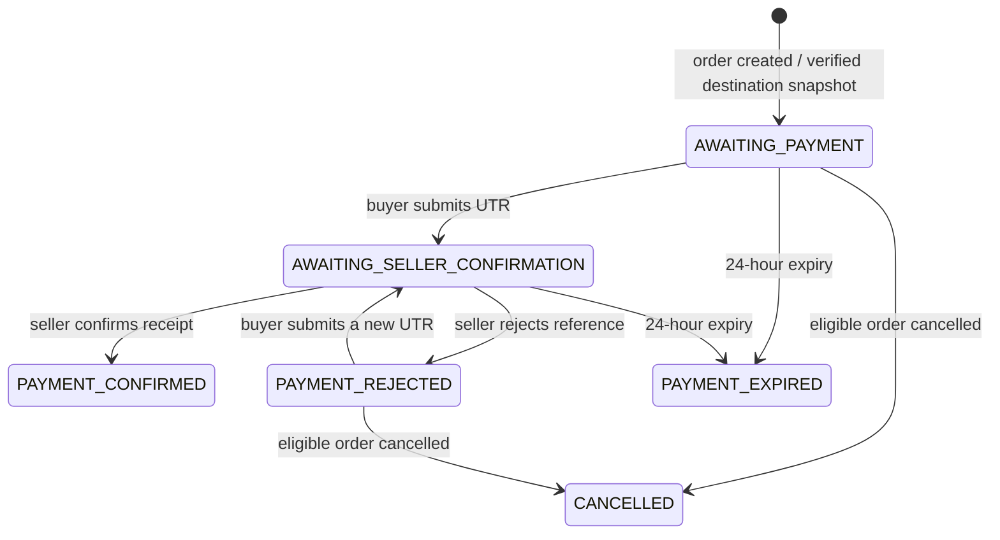

# Buyer Portal — Seller-Direct Payment and Support Design

**Branch:** `feat/buyer-portal-complete-seller-direct-checkout`  
**Status:** Implemented in source; automated verification and staging evidence pending  
**Migration sequence:** Java Flyway V48 (buyer ETA), SQL Flyway V49 (seller-direct payment, ownership, COD, support, idempotency)

## Fund-flow boundary

The buyer pays each seller directly using a seller UPI ID that an admin has explicitly verified and activated. KuraliUpdates does not receive, hold, pool, escrow, route or settle the funds. The platform records the buyer-submitted UTR and the seller's confirmation/rejection; it does not represent the UTR as bank-verified. Returning from an external UPI app is never a payment confirmation.

Admin verification is an explicit operational attestation after the admin checks seller ownership evidence outside this workflow. There is no bank-account ownership API or automatic UPI verification integration in this implementation.

## Payment lifecycle

Each seller suborder has its own payment record and state. A multi-seller checkout therefore permits partial payment without marking the whole checkout paid. Seller dispatch-ready transition is blocked for UPI orders until that suborder's payment is seller-confirmed.

## Data model

- `SELLER_PAYMENT_DESTINATIONS`: one current UPI destination per seller; pending/verified/rejected status; active flag; verifier and timestamps.
- `ORDER_SELLER_PAYMENTS`: one immutable seller destination snapshot and expected payable per UPI seller suborder; buyer user ID; checkout group; UTR; seller decision; 24-hour expiry; refund status/reference.
- `SELLER_PAYMENT_AUDIT`: append-only actor/action/state/reason records for destination, payment, COD and issue-status actions.
- `ORDER_ISSUES`: buyer issue report scoped to an authenticated buyer user ID and seller suborder.
- `BUYER_CHECKOUT_IDEMPOTENCY`: buyer-user-scoped key and request hash with the created order/group reference.
- `ORDERS.BUYER_USER_ID`: stable order ownership independent of whether the account has an email address.
- `SELLERS.COD_ENABLED`: admin-controlled per-seller COD eligibility; existing sellers default to enabled.

The existing `ORDERS.PAYMENT_STATUS` remains the order-level summary: `PENDING_UPI`, `PAID`, `PAYMENT_EXPIRED` or `CANCELLED` as applicable. Seller payment detail is authoritative in `ORDER_SELLER_PAYMENTS`.

## API contract

| Actor | Method and path | Purpose |
|---|---|---|
| Seller | GET `/sellers/me/payment-destination` | Read own destination and verification state |
| Seller | PUT `/sellers/me/payment-destination` | Submit/change own UPI ID; change resets verification and activation |
| Admin | GET `/admin/payment-destinations?status=PENDING_VERIFICATION` | Review queue |
| Admin | POST `/admin/payment-destinations/{sellerId}/review` | Verify/activate or reject seller destination |
| Buyer | GET `/buyers/orders/{orderId}/payment` | Read own seller-suborder payment |
| Buyer | GET `/buyers/orders/checkout-groups/{groupId}/payments` | Read own per-seller payment obligations |
| Buyer | POST `/buyers/orders/{orderId}/payment/utr` | Submit UTR with idempotency key |
| Seller | GET `/sellers/me/payments` | Read only own seller payments |
| Seller | POST `/sellers/me/payments/{paymentId}/decision` | Confirm or reject buyer-submitted UTR |
| Buyer | POST `/buyers/orders/{orderId}/payment/refund` | Request seller-funded refund |
| Seller | POST `/sellers/me/payments/{paymentId}/refund` | Initiate, complete (with actual reference) or reject refund |
| Buyer | POST `/buyers/orders/{orderId}/issues` | Report order issue |
| Admin | GET/PATCH `/admin/payment-destinations/order-issues` | Triage and resolve buyer issues |
| Admin | GET `/admin/payment-destinations/cod-settings` | Read seller COD eligibility |
| Admin | PUT `/admin/payment-destinations/{sellerId}/cod` | Enable/disable COD for a seller |

All buyer payment/support operations use the authenticated buyer's stable user ID, not a caller-supplied buyer email. Seller payment operations derive the seller ID from the authenticated seller token. Admin review/configuration requires an active admin authority. Payment rows are locked for UTR, confirmation and refund transitions.

## Checkout integrity and delivery

- Checkout accepts only COD or seller-direct UPI. Card, netbanking and platform-wallet payment are not enabled.
- COD is rejected server-side when the seller's `COD_ENABLED` flag is off.
- UPI is rejected unless the seller destination is verified and active. Its UPI ID/payee name is copied into the seller payment row at order creation; later destination edits do not change existing instructions.
- Checkout uses a buyer-scoped `Idempotency-Key` and SHA-256 request hash. Reuse with a different payload conflicts; a matching key replays the created order/group.
- UTR submission has its own idempotency key and globally unique UTR reference.
- Multi-seller delivery fee is allocated proportionally to each seller suborder's subtotal (last suborder receives rounding remainder); seller payment amounts are updated after the final allocation.
- Existing admin-configured maximum seller count is enforced. Per-seller delivery radius is checked against verified seller coordinates and buyer coordinates. Combined route uses Google road distance when available; otherwise a nearest-neighbour verified-coordinate estimate with a road-detour factor is used. If the required coordinates are absent/unverified, the coordinate-based check cannot establish a radius.
- Combined route limit uses `MAX_ROUTE_KM`. Store pickup skips delivery-radius/route checks.
- UPI seller orders cannot enter `READY_FOR_PICKUP` until seller confirmation. Delivery claim APIs accept only ready orders.
- Buyer and seller cancellation closes unpaid payment obligations. Paid orders cannot be cancelled through the unpaid-cancellation path.
- A payment request expires after 24 hours. A scheduled one-minute sweep selects expired rows with Oracle `FOR UPDATE SKIP LOCKED`, atomically updates the seller payment and order summary, and appends an expiry audit event. Buyer/seller reads also invoke the same expiry sweep as a defensive fallback. No external bank callback or background settlement is used.

## Refund and issue handling

Refunds are seller-funded. A buyer may request a refund only after seller-confirmed payment. The seller can mark the refund as initiated, reject the request, or record completion only with an actual external refund reference. This is a seller attestation, not a bank-verified refund. The platform does not issue the transfer.

Buyer issues are linked to the authenticated buyer and exact seller suborder. Admin can mark an issue in review or resolved. Status changes are audited. The current issue UI supports missing item, wrong item, damaged, poor quality, not delivered, payment, refund and other.

## Operational and security notes

- Never accept UTR, screenshot, UPI app return, or client payment status as proof.
- Never derive UPI ID from phone number.
- Do not add an aggregator, platform wallet, escrow, pooled funds or seller payout automation without a new approved business/legal design.
- A seller editing its UPI destination immediately disables it and requires a fresh admin review.
- Buyer order/payment/issue access is scoped by stable user ID. Seller payment reads/decisions/refunds are scoped by the authenticated seller ID. Admin routes require ROLE_ADMIN.
- Audit rows include actor, role, action, previous/next state, reason and timestamp.
- Checkout keys are retained for replay protection. UTR references are unique across payment records.
- Do not log payment instructions, UTR values, buyer secrets or authentication tokens unnecessarily.

## Migrations and rollback

- V48: re-versions the ETA column migration. This removes the duplicate V22 version collision with the existing bargain lifecycle migration.
- V49: adds order buyer-user ownership and seller COD configuration; creates seller destination, seller payment, payment audit, order issue and checkout idempotency tables/indexes.
- No staging database was modified during implementation.
- Before applying V48/V49 in any environment, take a database backup and verify Flyway migration discovery on the exact deployment artifact.
- Do not drop V49 tables in a live environment after payment/issue records exist. A rollback should first disable seller UPI destinations and return new checkouts to COD where enabled, preserve all existing payment/audit/issue records for reconciliation, then use a reviewed data-preserving schema rollback plan.

## Explicit verification gaps

- No UPI bank API/PSP verification; admin attestation and seller confirmation are operational controls, not bank verification.
- No external refund execution or independent refund verification; seller records the actual refund reference.
- 24-hour expiry is applied when payment APIs are read/reviewed; no scheduled expiry worker.
- Coordinate radius checks require verified seller and buyer coordinates. Unverified/missing coordinates cannot prove the radius.
- Smart multilingual catalogue synonym/transliteration expansion, Buy Again/favourites/lists and full accessibility review remain separate buyer-experience work.
- CI, Oracle migration execution, staging buyer/seller/admin E2E, concurrency/idempotency rehearsal and production deployment have not been claimed until GitHub/staging evidence is available.
