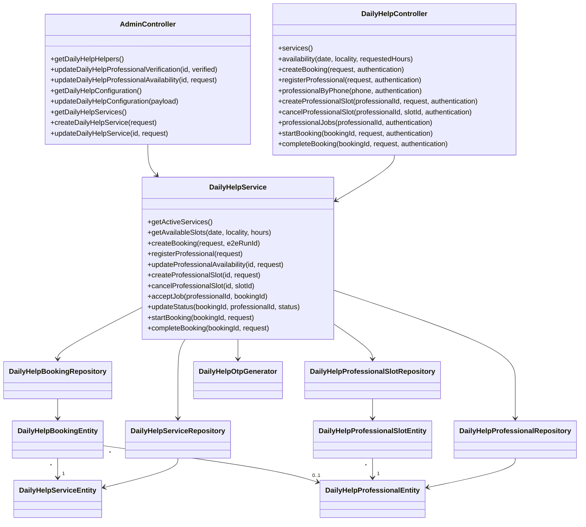
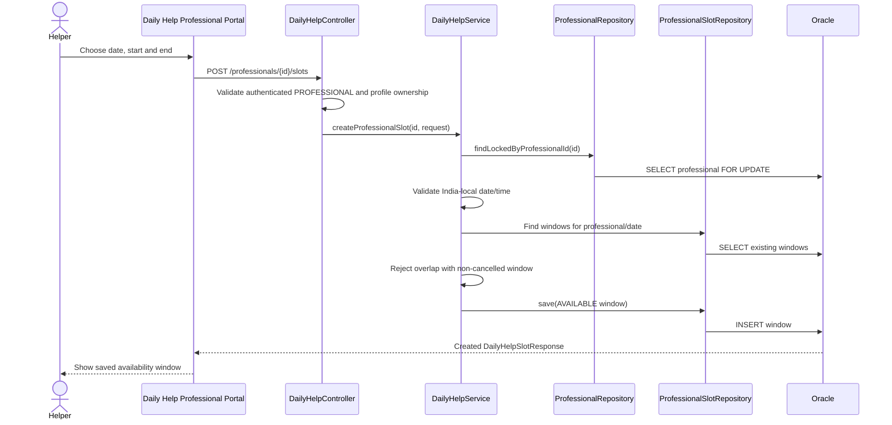
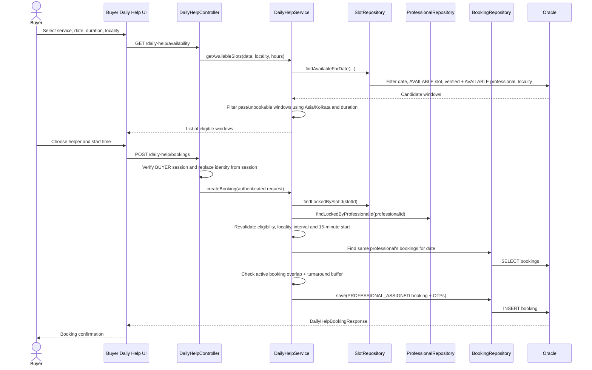
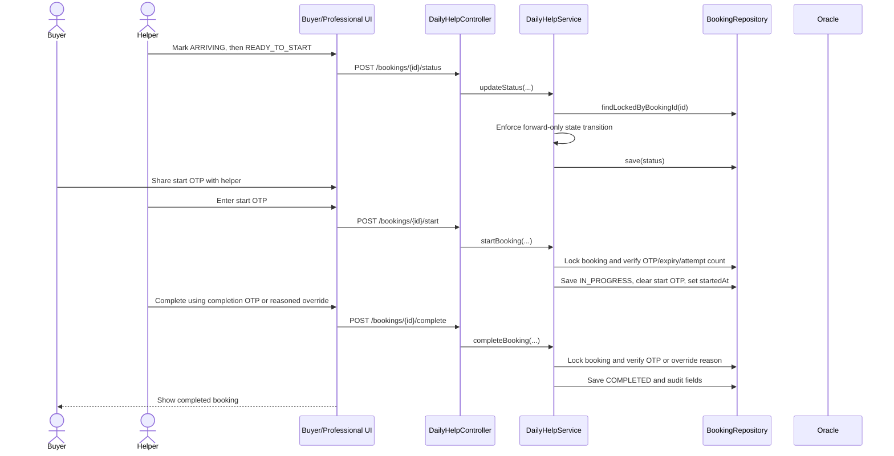

# Daily Help — End-to-End Functional and Technical Design

> Source-aligned documentation for the current implementation. Controller, service, DTO, entity, repository and frontend API source are authoritative. Where the original table-creation migration is not present in the current migration directory, the schema below documents the JPA-mapped design; it does not pretend to be a verbatim Oracle DDL extract.

## 1. Purpose and scope

Daily Help is a local services marketplace. Buyers choose an active service, date, duration and a start time inside a professional's published availability window. A professional registers against an authenticated account, is approved by Admin, publishes date-specific availability and manages assigned jobs. Admin manages professional verification, professional availability, service catalogue and turnaround-buffer configuration.

This document covers:
- Buyer discovery, booking, history and cancellation
- Professional registration, approval, online status, availability windows and job lifecycle
- Admin configuration and catalogue/verification operations
- REST API contracts and authorization
- Oracle data model and relationships
- Backend class structure and request sequences
- Validation, concurrency, OTP and operational considerations

**Not covered as implemented features:** online payment/escrow, customer reviews submission, automatic dispatch to a professional, recurring availability rules, or a separate slot-to-booking foreign key. Do not infer these from the marketplace description.

## 2. Roles and business rules

| Actor | Responsibilities | Authorization boundary |
|---|---|---|
| Buyer | Browse services, search available windows, book, view own bookings, cancel eligible future booking | Authenticated BUYER session; phone identity must match own account |
| Professional | Register own profile, set online status, create/cancel own windows, view/accept jobs, update job state, start/complete service | Authenticated PROFESSIONAL session; profile resolved by authenticated phone and professional ID |
| Admin | Verify/revoke professionals, manage professional availability, manage services, configure turnaround buffer | Admin controller security policy |
| Backend | Availability filtering, price snapshot, conflict checks, locking, OTP and state transitions | Service layer and database transaction |

### Key rules

1. A professional profile starts with `status=OFFLINE` and `verified=0`.
2. A professional can set `status=AVAILABLE` only after verification.
3. Buyer discovery returns slots only when the slot is `AVAILABLE`, the professional is `AVAILABLE`, and `verified=1`.
4. Buyer locality filtering is case-insensitive exact match, except null/blank locality or the broad locality value `Kurali`, which does not restrict professional locality.
5. Availability is a date-specific continuous window, not a pre-divided one-hour slot. Buyers choose a start time in 15-minute increments and a duration that fits in the window.
6. All buyer discovery and booking comparisons use India local time (`Asia/Kolkata`) in the service logic.
7. Existing active bookings are checked with an admin-configurable turnaround buffer. The default is 15 minutes if the config row is absent.
8. A professional row is pessimistically locked during booking so concurrent bookings for the same professional are serialized, including bookings at different non-overlapping times.
9. The selected availability window row is locked when booking. The booking itself stores scheduled start and requested duration; the window is not split into child slots.
10. Buyer cancellation is allowed only for future bookings in `PROFESSIONAL_ASSIGNED`, `ARRIVING` or `READY_TO_START`, before start OTP verification/service start.

## 3. End-to-end functional flows

### 3.1 Professional onboarding and approval

1. Professional signs in to an existing KuraliUpdates account.
2. Frontend sends registration details: name, authenticated phone, locality and ward number.
3. API verifies that request phone matches the authenticated account phone.
4. Existing profile by phone is updated; otherwise a new profile is created with `OFFLINE`, `verified=0`, rating 0 and review count 0.
5. Admin reviews the profile and sets `verified=true`.
6. Professional can now toggle status to `AVAILABLE`; attempting this before approval returns HTTP 409.
7. Revoking verification sets `verified=0` and forces status to `OFFLINE`.

### 3.2 Professional publishes availability

1. Professional chooses a date, start time and end time.
2. Frontend posts the window to `POST /daily-help/professionals/{professionalId}/slots`.
3. Backend verifies profile ownership and checks:
   - Date is today or later in Asia/Kolkata.
   - End is after start.
   - For today's date, start is in the future in Asia/Kolkata.
   - Window does not overlap another non-cancelled window for that professional/date.
4. Backend creates a `DHS-...` slot with status `AVAILABLE`.
5. Professional can read all their windows for a date or cancel an eligible window. A window containing an active booking cannot be cancelled.

A window can be long (for example 09:00–23:00). It remains one database row. The buyer chooses an appointment interval within it.

### 3.3 Buyer discovers and books a helper

1. Buyer opens an active service from `GET /daily-help/services`.
2. Buyer selects date, requested duration and optionally locality.
3. Frontend calls `GET /daily-help/availability?date=...&requestedHours=...&locality=...`.
4. Repository query filters by date, slot status, professional verification/status and locality, and retrieves windows intersecting the day.
5. Service filters out windows that cannot fit the requested duration at the next valid 15-minute start time, considering the current Asia/Kolkata time.
6. Frontend presents eligible helper windows and start-time choices. A selected start must be within the window, fit the requested duration and not be in the past.
7. Buyer submits service ID, slot ID, scheduled start, duration and service address/locality.
8. Controller derives buyer name and phone from the authenticated `UserEntity`; supplied identity cannot impersonate another account.
9. Service locks the selected slot and professional, revalidates status/verification/date/time/duration, then checks active bookings plus turnaround buffer.
10. On success, booking is stored as `PROFESSIONAL_ASSIGNED`; the hourly rate and estimated total are snapshotted from the service at booking time. Start and completion OTPs are generated.
11. Buyer sees the booking in current/booking history APIs. The booking is assigned directly to the selected professional; there is no separate accept step for this buyer-selected path.

### 3.4 Professional job lifecycle and OTP

State progression for a directly assigned booking:

`PROFESSIONAL_ASSIGNED → ARRIVING → READY_TO_START → IN_PROGRESS → COMPLETED`

- Professional moves the booking to `ARRIVING`, then `READY_TO_START`.
- Buyer-held start OTP is exposed only to the buyer for eligible active states; professional submits the OTP to start the service.
- Start OTP expires after 15 minutes; invalid attempts are counted and limited to five. Successful verification clears the start OTP and records `serviceStartedAt`.
- Completion uses a customer completion OTP. If unavailable, professional may submit an override reason of at least 10 characters (maximum 1000); override actor/reason/time are persisted for audit.
- Completion records `serviceCompletedAt` and status `COMPLETED`.
- Status updates are forward-only; retries of the current state are idempotent.

There is also an unassigned `SEARCHING` job path in the professional API: available jobs are filtered by the professional's exact locality, and an available professional can accept a still-unassigned job. This path is distinct from the buyer-selected slot booking flow.

### 3.5 Buyer booking history and cancellation

- `GET /daily-help/bookings?buyerPhone=...` returns the authenticated buyer's bookings ordered by scheduled start descending.
- `GET /daily-help/bookings/latest?buyerPhone=...` returns the latest created booking (or null).
- `GET /daily-help/bookings/{bookingId}` is limited to the buyer or assigned professional by phone identity.
- Buyer cancellation changes status to `CANCELLED_BY_BUYER`, clears start OTP/expiry, and is allowed only before scheduled start and before the service has started/OTP has been verified.
- Completed and cancelled records remain in booking history.

### 3.6 Admin operations

Admin endpoints provide:
- Professional directory
- Verification approve/revoke
- Professional status override
- Daily Help configuration read/update (turnaround buffer)
- Service catalogue list/create/update

Service catalogue fields include category, name, description, pricing unit, hourly rate, minimum hours, image URL and active flag. Buyer service discovery returns active services only.

## 4. REST API reference

Base path: `/api/v1`. Unless stated otherwise, authenticated requests use `Authorization: Bearer <session-token>`. JSON is used for request/response bodies.

### 4.1 Public/service discovery and buyer APIs

| Method | Path | Auth | Purpose |
|---|---|---|---|
| GET | `/daily-help/services` | Public | Active service catalogue |
| GET | `/daily-help/availability?date=YYYY-MM-DD&requestedHours=1[&locality=...]` | Public | Eligible professional availability windows |
| POST | `/daily-help/bookings` | BUYER | Create a booking from selected slot/window |
| GET | `/daily-help/bookings?buyerPhone=...` | BUYER + own phone | Buyer booking history |
| GET | `/daily-help/bookings/latest?buyerPhone=...` | BUYER + own phone | Latest created booking |
| GET | `/daily-help/bookings/{bookingId}` | BUYER or PROFESSIONAL owner | Booking detail |
| POST | `/daily-help/bookings/{bookingId}/cancel` | BUYER | Cancel eligible future booking |

Availability query parameters:
- `date`: required ISO local date.
- `requestedHours`: required positive decimal hours.
- `locality`: optional. Blank/null and `Kurali` mean no locality restriction; a specific locality is exact case-insensitive match.

Example:
```http
GET /api/v1/daily-help/availability?date=2026-11-25&requestedHours=1&locality=Kurali
```

### 4.2 Professional APIs

| Method | Path | Auth | Purpose |
|---|---|---|---|
| POST | `/daily-help/professionals/register` | Authenticated account; phone must match | Create/update own profile |
| GET | `/daily-help/professionals/by-phone/{phone}` | Own phone only | Read own profile |
| POST | `/daily-help/professionals/{professionalId}/availability` | PROFESSIONAL; own profile | Set `AVAILABLE` or `OFFLINE` |
| GET | `/daily-help/professionals/{professionalId}/slots?date=YYYY-MM-DD` | PROFESSIONAL; own profile | Read own windows for date |
| POST | `/daily-help/professionals/{professionalId}/slots` | PROFESSIONAL; own profile | Create availability window |
| DELETE | `/daily-help/professionals/{professionalId}/slots/{slotId}` | PROFESSIONAL; own profile | Cancel window |
| GET | `/daily-help/professionals/{professionalId}/jobs/available` | PROFESSIONAL; own profile | Read unassigned `SEARCHING` jobs in exact locality |
| POST | `/daily-help/professionals/{professionalId}/jobs/{bookingId}/accept` | PROFESSIONAL; own profile | Accept an unassigned job |
| GET | `/daily-help/professionals/{professionalId}/jobs` | PROFESSIONAL; own profile | Read own jobs |
| GET | `/daily-help/professionals/{professionalId}/earnings` | PROFESSIONAL; own profile | Today/lifetime completed earnings |

Create slot body:
```json
{
  "slotDate": "2026-11-25",
  "startTime": "09:00:00",
  "endTime": "23:00:00"
}
```

Set availability body:
```json
{ "status": "AVAILABLE", "locality": "Kurali" }
```

### 4.3 Booking lifecycle APIs

| Method | Path | Auth | Purpose |
|---|---|---|---|
| POST | `/daily-help/bookings/{bookingId}/status` | Assigned professional | Move to `ARRIVING` or `READY_TO_START` |
| POST | `/daily-help/bookings/{bookingId}/start` | Assigned professional | Verify start OTP and begin service |
| POST | `/daily-help/bookings/{bookingId}/complete` | Assigned professional | Complete with customer OTP or audited override |

Status body:
```json
{ "professionalId": "DHP-...", "status": "ARRIVING" }
```

Start body:
```json
{ "professionalId": "DHP-...", "otp": "1234" }
```

Complete body (one of the two completion methods):
```json
{ "professionalId": "DHP-...", "otp": "1234" }
```
or
```json
{ "professionalId": "DHP-...", "overrideReason": "Customer phone unavailable; completion confirmed in person." }
```

Booking request shape:
```json
{
  "serviceId": "DH-...",
  "buyerName": "Buyer Name",
  "buyerPhone": "9999999999",
  "address": "House / street address",
  "locality": "Kurali",
  "scheduledStart": "2026-11-25T10:00:00",
  "requestedHours": 1,
  "slotId": "DHS-..."
}
```
The controller replaces `buyerName` and `buyerPhone` with the authenticated account's values. Treat request identity fields as compatibility fields, not trusted identity.

### 4.4 Admin APIs

Admin controller routes are under `/api/v1/admin`:

| Method | Path | Purpose |
|---|---|---|
| GET | `/admin/daily-help/helpers` | List professional profiles |
| POST | `/admin/daily-help/helpers/{professionalId}/verification?verified=true|false` | Approve/revoke professional |
| POST | `/admin/daily-help/helpers/{professionalId}/availability` | Admin availability override |
| GET | `/admin/daily-help/configuration` | Read turnaround buffer |
| PUT | `/admin/daily-help/configuration` | Update turnaround buffer (0–120 minutes) |
| GET | `/admin/daily-help/services` | List all services |
| POST | `/admin/daily-help/services` | Create service |
| PUT | `/admin/daily-help/services/{serviceId}` | Update service |

Service create/update request fields: `category`, `name`, optional `description`, `pricingUnit`, `pricePerHour`, `minHours`, optional `imageUrl`, `active`.

### 4.5 Important response fields

Availability response (`DailyHelpSlotResponse`):
- `slotId`, `professionalId`, `professionalName`, `locality`
- `slotDate`, `startTime`, `endTime`, `status`, `bookingId`, `rating`

Booking response (`DailyHelpBookingResponse`):
- Booking/service identity and name
- Buyer contact/address/locality
- `scheduledStart`, `requestedHours`, `hourlyRate`, `estimatedTotal`
- `status`, assigned professional identity/contact
- `startOtp`, `otpVerifiedAt`, `serviceStartedAt`, `serviceCompletedAt`
- `completionOtp`, `completionOverrideReason`, `completionOverrideAt`

OTP response exposure is state- and actor-sensitive. The DTO mapper only includes start OTP when the service asks to expose it; the controller's buyer booking paths and professional mutation paths use different exposure flags. Do not log or persist OTP values in frontend telemetry.

## 5. Oracle database design

### 5.1 Core tables and ownership

| Table | JPA entity | Purpose |
|---|---|---|
| `DAILY_HELP_SERVICES` | `DailyHelpServiceEntity` | Admin-managed service catalogue and price |
| `DAILY_HELP_PROFESSIONALS` | `DailyHelpProfessionalEntity` | Professional profile, identity link, locality, status and verification |
| `DAILY_HELP_PROFESSIONAL_SLOTS` | `DailyHelpProfessionalSlotEntity` | Date-specific continuous availability windows |
| `DAILY_HELP_BOOKINGS` | `DailyHelpBookingEntity` | Booking, price snapshot, lifecycle and OTP audit fields |
| `KU_COMPLIANCE_CONFIG` | JDBC configuration access | `DAILY_HELP_TURNAROUND_MINUTES` operational setting |

The four Daily Help entity/table mappings above are confirmed in the current JPA source. The original create-table DDL was not found in the currently enumerated migration files; verify the deployed Oracle dictionary or historical baseline before treating this mapping as a complete physical DDL specification.

### 5.2 Entity fields

#### DAILY_HELP_SERVICES

| Column | Java type | Meaning |
|---|---|---|
| SERVICE_ID (PK) | String | Stable service ID |
| CATEGORY | String | Service category |
| NAME | String | Display name |
| DESCRIPTION | String | Description |
| PRICING_UNIT | String | Pricing unit (current service uses hourly pricing) |
| PRICE_PER_HOUR | BigDecimal(10,2) | Current catalogue rate |
| MIN_HOURS | Integer | Minimum duration configured for service |
| IMAGE_URL | String | Catalogue image |
| ACTIVE | Integer | 1 means buyer-visible |
| CREATED_AT, UPDATED_AT | LocalDateTime | Audit timestamps |
| E2E_RUN_ID | String | Synthetic test ownership tag |

#### DAILY_HELP_PROFESSIONALS

| Column | Java type | Meaning |
|---|---|---|
| PROFESSIONAL_ID (PK) | String | Professional profile ID |
| USER_ID | String, nullable | Optional linked user ID |
| FULL_NAME | String | Display name |
| PHONE | String | Phone identity; profile lookup uses normalized digits |
| RATING | BigDecimal(3,2) | Rating aggregate |
| REVIEW_COUNT | Integer | Review count |
| CURRENT_LOCALITY | String | Service locality |
| WARD_NUMBER | String | Ward |
| STATUS | String | `AVAILABLE` or `OFFLINE` |
| VERIFIED | Integer | 1 approved, 0 unverified |
| CURRENT_LATITUDE, CURRENT_LONGITUDE | BigDecimal | Optional location |
| REGISTERED_AT, UPDATED_AT | LocalDateTime | Audit timestamps |

#### DAILY_HELP_PROFESSIONAL_SLOTS

| Column | Java type | Meaning |
|---|---|---|
| SLOT_ID (PK) | String | Window ID |
| PROFESSIONAL_ID (FK) | Relationship | Owning professional |
| SLOT_DATE | LocalDate | Availability date |
| START_TIME, END_TIME | LocalTime | Continuous availability bounds |
| STATUS | String | `AVAILABLE` or `CANCELLED` (legacy `BOOKED` guard exists) |
| BOOKING_ID | String, nullable | Legacy booking association field; current new booking flow does not set it |
| CREATED_AT, UPDATED_AT | LocalDateTime | Audit timestamps |
| E2E_RUN_ID | String | Synthetic test ownership tag |

Unique constraint in entity mapping: `UK_DH_PROF_SLOT(PROFESSIONAL_ID, SLOT_DATE, START_TIME, END_TIME)`. Application logic additionally rejects overlap with any non-cancelled window for the same professional/date.

#### DAILY_HELP_BOOKINGS

| Column | Java type | Meaning |
|---|---|---|
| BOOKING_ID (PK) | String | Booking ID |
| SERVICE_ID (FK) | Relationship | Service selected |
| PROFESSIONAL_ID (FK, nullable) | Relationship | Assigned professional |
| BUYER_NAME, BUYER_PHONE | String | Buyer snapshot |
| ADDRESS, LOCALITY | String | Service location snapshot |
| SCHEDULED_START | LocalDateTime | Appointment start |
| REQUESTED_HOURS | BigDecimal(4,1) | Requested duration |
| HOURLY_RATE | BigDecimal(10,2) | Rate snapshot at booking |
| ESTIMATED_TOTAL | BigDecimal(10,2) | Rate × requested hours snapshot |
| STATUS | String | Booking lifecycle state |
| START_OTP, OTP_EXPIRES_AT, OTP_ATTEMPTS, OTP_VERIFIED_AT | String/DateTime/Integer | Start consent OTP lifecycle |
| SERVICE_STARTED_AT, SERVICE_COMPLETED_AT | LocalDateTime | Actual service timestamps |
| COMPLETION_OTP, COMPLETION_OTP_ATTEMPTS, COMPLETION_OTP_VERIFIED_AT | String/Integer/DateTime | Completion OTP lifecycle |
| COMPLETION_OVERRIDE_REASON, COMPLETION_OVERRIDE_BY, COMPLETION_OVERRIDE_AT | String/String/DateTime | Audited override |
| E2E_RUN_ID | String | Synthetic test ownership tag |
| CREATED_AT, UPDATED_AT | LocalDateTime | Audit timestamps |

### 5.3 Relationships

- One service has many bookings.
- One professional has many availability windows.
- One professional can have many bookings.
- A booking references one service and optionally one professional.
- Slot `BOOKING_ID` is not the authoritative booking-to-slot relationship for newly created bookings. The current booking entity has no slot field; booking-time conflict detection is based on professional + scheduled start + requested duration.
- `E2E_RUN_ID` fields support synthetic test isolation/cleanup and are not customer-facing business identifiers.

### 5.4 Indexing and integrity notes

Entity source confirms a unique constraint on professional/date/start/end for windows. Repository queries filter windows by date/status and join professional status/verification/locality. Booking overlap checks query bookings by professional and scheduled-start date range. Review deployed indexes and constraints in Oracle before adding new ones; do not infer indexes from repository method names.

## 6. Backend class design

### 6.1 Main classes

| Layer | Class | Responsibility |
|---|---|---|
| Controller | `DailyHelpController` | Buyer/professional routes, authentication, role and ownership checks |
| Controller | `AdminController` | Admin service, verification, status and config endpoints |
| Service | `DailyHelpService` | Business rules, transactional writes, availability discovery, booking and lifecycle |
| Service | `DailyHelpOtpGenerator` | OTP generation |
| Repository | `DailyHelpServiceRepository` | Service catalogue persistence |
| Repository | `DailyHelpProfessionalRepository` | Professional lookup and pessimistic lock |
| Repository | `DailyHelpProfessionalSlotRepository` | Slot CRUD, date availability query and pessimistic lock |
| Repository | `DailyHelpBookingRepository` | Booking reads and pessimistic lock |
| Entity | Four Daily Help entities | JPA persistence model |
| DTO | `DailyHelp*Request/Response` | Validated API boundary and response mapping |
| Frontend | `dailyHelpApi` | Buyer service/availability/booking API calls |
| Frontend | `dailyHelpProviderApi` | Professional profile/slot/job/lifecycle API calls |
| Frontend | `DailyHelpHome` | Buyer service selection and booking UI |
| Frontend | `useDailyHelpProviderOperations` | Professional state and API orchestration |
| Frontend | `DailyHelpPortal` | Professional portal presentation |

### 6.2 Class diagram



## 7. Sequence diagrams

### 7.1 Professional creates an availability window



### 7.2 Buyer discovers availability and books



### 7.3 Professional starts and completes service



## 8. Validation, concurrency and security

- **Identity:** Buyer booking name/phone are derived from authenticated user. Buyer history and cancellation compare the authenticated phone to booking phone. Professional routes verify role and that the requested profile belongs to the authenticated phone.
- **Verification:** Admin approval is a prerequisite to professional `AVAILABLE` state and buyer discovery. Revocation forces `OFFLINE`.
- **Availability:** Discovery is not a reservation/hold. Booking always rechecks the window and all eligibility rules.
- **Concurrency:** Pessimistic locks are used on the selected slot, professional and booking during relevant mutations. The professional lock serializes competing bookings for one professional.
- **Time:** Business checks explicitly use `Asia/Kolkata` for availability and booking; `LocalDateTime` values are persisted without a zone offset. API clients should send India-local date/time values and must not convert them to UTC.
- **Overlap:** New windows cannot overlap existing non-cancelled windows. Booking conflict checks consider `PROFESSIONAL_ASSIGNED`, `ARRIVING`, `READY_TO_START` and `IN_PROGRESS` bookings and apply the configured buffer.
- **OTP:** Start OTP expires in 15 minutes; start and completion attempts are capped at five. Completion override requires a reason (10–1000 chars) and stores actor/time/reason.
- **No slot reservation:** Selecting a window in the UI does not hold it. Two buyers may see the same availability; the booking transaction decides the winner. A losing request should handle HTTP 409 and refresh availability.
- **No OTP logging:** Never log OTPs, bearer tokens or full private addresses in diagnostics.

## 9. Error and response expectations

| HTTP status | Typical cause |
|---|---|
| 400 | Missing/invalid date, duration, time, status, OTP format, overlap or booking interval outside window |
| 401 | Missing/invalid authenticated session |
| 403 | Role mismatch, phone mismatch or attempt to manage another professional/booking |
| 404 | Unknown service, professional, slot or booking |
| 409 | Unverified professional, professional not available, slot no longer available, booking conflict, invalid state transition or cancellation not allowed |
| 429 | Too many invalid OTP attempts |

Frontend clients currently convert some read failures to empty arrays/null. When troubleshooting “No matching availability”, inspect the network response and server query inputs rather than assuming an empty list always means no helper has published a window.

## 10. Test and acceptance matrix

| Scenario | Expected result |
|---|---|
| New professional registers | Profile exists as OFFLINE and unverified |
| Unverified professional toggles AVAILABLE | HTTP 409 |
| Admin approves professional | VERIFIED=1 |
| Approved professional toggles AVAILABLE | Profile status AVAILABLE |
| Professional creates future non-overlapping window | AVAILABLE window persisted and returned |
| Professional creates overlapping window | HTTP 409 |
| Buyer searches exact date and compatible duration | Only eligible windows returned |
| Buyer locality Kurali | Broad locality search; no exact professional locality constraint |
| Buyer locality is a specific neighbourhood | Case-insensitive exact locality match |
| Window is partly in the past | Window returned only if a future 15-minute start fits duration |
| Requested duration cannot fit | Window excluded |
| Buyer books valid time | One assigned booking; rate/total snapshot persisted |
| Two buyers race for overlapping time | At most one succeeds; other receives conflict |
| Booking falls inside turnaround buffer | Conflict |
| Buyer tries another account's phone | HTTP 403 |
| Buyer cancels future unstarted booking | CANCELLED_BY_BUYER; start OTP cleared |
| Buyer cancels started/past/completed booking | HTTP 409 |
| Professional enters wrong start OTP | Attempt incremented; service does not start |
| Professional enters correct start OTP | IN_PROGRESS and serviceStartedAt set |
| Professional completes with correct OTP | COMPLETED and completion timestamp set |
| Professional uses completion override | Reason/actor/time persisted |
| Admin revokes verification | Professional forced OFFLINE and excluded from buyer search |

Relevant automated tests:
- `backend-java-spring/src/test/java/com/kuraliupdates/bazaar/service/DailyHelpServiceTest.java`
- `backend-java-spring/src/test/java/com/kuraliupdates/bazaar/controller/DailyHelpControllerTest.java`
- `backend-java-spring/src/test/java/com/kuraliupdates/bazaar/service/DailyHelpOtpGeneratorTest.java`
- `e2e/order-daily-help-lifecycle.spec.ts`

## 11. Troubleshooting buyer sees no helpers

Check in this order, using the exact requested date and duration:

1. Confirm the helper profile exists and the phone maps to the signed-in professional account.
2. Confirm Admin has set `VERIFIED=1`.
3. Confirm professional `STATUS='AVAILABLE'`.
4. Confirm a row exists in `DAILY_HELP_PROFESSIONAL_SLOTS` for the buyer's exact date with `STATUS='AVAILABLE'`.
5. Confirm the window has sufficient remaining duration after the current Asia/Kolkata time.
6. Confirm the buyer locality is blank/`Kurali` or matches `CURRENT_LOCALITY` exactly ignoring case and surrounding whitespace.
7. Inspect the actual `GET /api/v1/daily-help/availability` response and request query parameters.
8. If the API returns a slot but UI does not show it, inspect buyer-side mapping, filtering and state refresh.
9. If API returns an empty array, inspect repository predicate values and the persisted Oracle rows. Do not remove verification or status filters as a workaround.

Useful read-only Oracle checks (run only against the intended environment and bind values):

```sql
SELECT PROFESSIONAL_ID, FULL_NAME, PHONE, CURRENT_LOCALITY, STATUS, VERIFIED
FROM DAILY_HELP_PROFESSIONALS
WHERE REGEXP_REPLACE(PHONE, '[^0-9]', '') = :phone_digits;

SELECT SLOT_ID, PROFESSIONAL_ID, SLOT_DATE, START_TIME, END_TIME, STATUS
FROM DAILY_HELP_PROFESSIONAL_SLOTS
WHERE PROFESSIONAL_ID = :professional_id
  AND SLOT_DATE = :slot_date
ORDER BY START_TIME;

SELECT BOOKING_ID, PROFESSIONAL_ID, SCHEDULED_START, REQUESTED_HOURS, STATUS
FROM DAILY_HELP_BOOKINGS
WHERE PROFESSIONAL_ID = :professional_id
  AND SCHEDULED_START >= :day_start
  AND SCHEDULED_START < :next_day_start
ORDER BY SCHEDULED_START;
```

Do not expose phone numbers, customer addresses or OTP fields in support screenshots/logs. Do not run data-changing SQL to make a helper appear.

## 12. Source map and maintenance

Primary source files:
- `backend-java-spring/src/main/java/com/kuraliupdates/bazaar/controller/DailyHelpController.java`
- `backend-java-spring/src/main/java/com/kuraliupdates/bazaar/controller/AdminController.java`
- `backend-java-spring/src/main/java/com/kuraliupdates/bazaar/service/DailyHelpService.java`
- `backend-java-spring/src/main/java/com/kuraliupdates/bazaar/repository/DailyHelp*Repository.java`
- `backend-java-spring/src/main/java/com/kuraliupdates/bazaar/entity/DailyHelp*Entity.java`
- `backend-java-spring/src/main/java/com/kuraliupdates/bazaar/dto/dailyhelp/`
- `src/services/domains/dailyHelpApi.ts`
- `src/services/domains/dailyHelpProviderApi.ts`
- `src/components/Buyer/DailyHelpHome.tsx`
- `src/features/daily-help/useDailyHelpProviderOperations.ts`
- `src/features/daily-help/DailyHelpPortal.tsx`

When changing Daily Help:
1. Update DTO validation and controller authorization.
2. Update service rules and repository predicates/locking together.
3. Add/update service and controller tests.
4. Update buyer/provider API clients and E2E lifecycle coverage.
5. Update this document and `docs/API.md` if public contracts or authorization change.
6. Update `docs/DATABASE.md` and add a forward-only Flyway migration if schema changes.
7. Verify deployed Oracle schema and staging/production behavior independently; a successful build alone is not runtime evidence.
